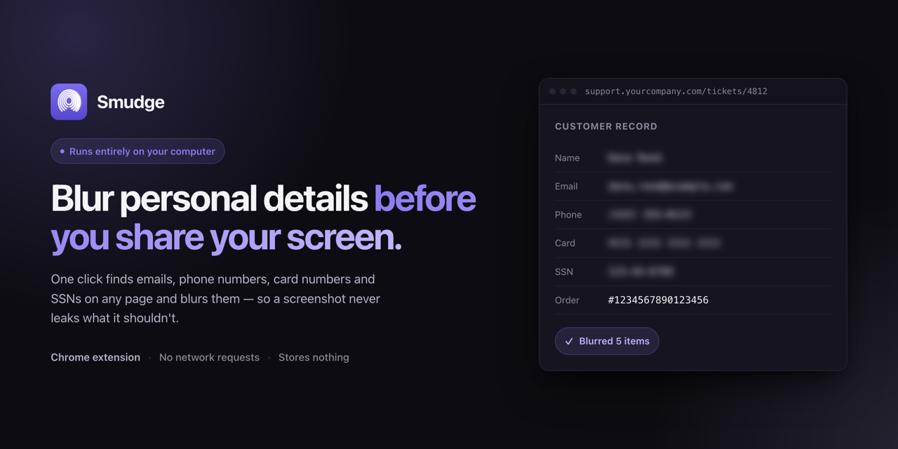

# Smudge

A Chrome extension that finds personal details on a web page — emails, phone
numbers, card numbers, payment addresses and ID numbers — and blurs them before
you take a screenshot or share your screen.

Everything runs locally. No network requests, nothing saved to disk, no
account.

**[Download and try it →](https://imashutoshgupta.github.io/smudge/)** — the
site has a live demo you can type into, plus install steps.

## Install

Smudge isn't on the Chrome Web Store yet, so install it from source. It takes
about a minute.

1. Download this repository — **Code → Download ZIP** — and unzip it. Or clone
   it: `git clone https://github.com/imAshutoshGupta/smudge.git`
2. Open `chrome://extensions` in Chrome (or `edge://extensions` in Edge)
3. Turn on **Developer mode**, top right
4. Click **Load unpacked** and select the unzipped folder
5. Click the puzzle-piece icon in the toolbar and pin Smudge

Chrome will show a "Developer mode extensions" notice on startup. That's
expected for any extension installed this way.

## Use

1. Open the page you want to share
2. Click the Smudge icon → **Scan & blur this page**
3. Anything it missed, blur yourself: **Enable click-to-blur**, then click any
   part of the page. Click a blurred thing to bring it back. Esc exits.
4. **Save screenshot** writes a PNG of the visible area to your Downloads, with
   the blurs baked in. Or leave the blurs up while you share your screen.
5. **Clear all blurs** puts the page back exactly as it was

Untick a category in the popup to reveal just that kind of item again.

### Moving between pages

Showing someone around a site with several pages? Switch on **Keep blurs as I
move around this site** in the popup. Chrome asks once to let Smudge onto that
site. From then on:

- what you blurred on a page comes back when you return to it, whether the
  site loads a new page each time or is a single-page app;
- if you scanned, every other page of the site is scanned as it loads;
- unticked categories and items you clicked to reveal stay that way.

It lasts until you press **Clear all blurs**, switch it off, or close the
browser. Smudge remembers where your blurs were, in your browser's memory on
your computer, never the text itself. On a slow page you may see a detail for
a split second before its blur goes on: blurs go on from the top of the page
down as it arrives, but Smudge never holds the page back.

## Privacy

No data is collected or transmitted, and nothing is saved to disk. See
[PRIVACY.md](PRIVACY.md).

## License

Copyright © 2026 Ashutosh Gupta. All rights reserved.

The source is public so that anyone using the extension can read it and check
that the privacy claims above are true. You're welcome to read it and to run
the extension yourself — but copying, modifying or redistributing it needs
written permission. See [LICENSE](LICENSE).
